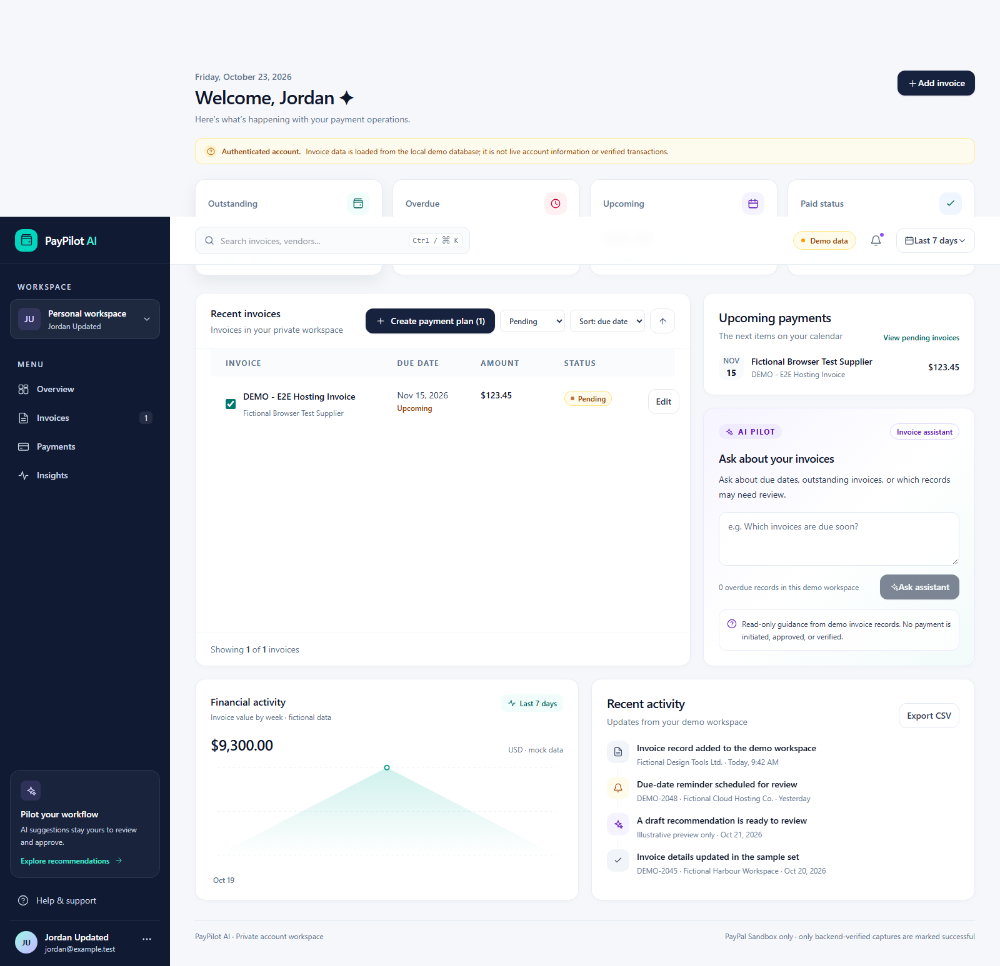

# PayPilot AI

PayPilot AI is a fictional-business payment operations dashboard that helps a
small business review invoices, ask read-only AI questions, prepare and approve
versioned payment plans, and complete payments in PayPal Sandbox. It is a
hackathon/demo project, not a production accounting or payment system.



All seeded records and automated provider responses are fictional. PayPal
Sandbox tests do not move real money. No transaction is described as successful
unless the API verifies a final provider capture.

## Project status

### Implemented

- Responsive React, TypeScript, Vite, and Tailwind dashboard with invoice
  listing, filtering, sorting, pagination, invoice details, and create/edit
  forms.
- Express API with request validation, owner-scoped repository/service
  boundaries, centralized errors, and SQLite persistence using Prisma.
- Email/password account registration and sign-in, scrypt password hashes,
  expiring server-side sessions in SQLite, HttpOnly cookies, persisted profile
  editing, and session-revoking sign-out.
- Deterministic fictional Northstar Studio seed data across pending, overdue,
  paid, and cancelled invoice states.
- Read-only Gemini invoice assistant with bounded owner-scoped context,
  structured-output validation, invoice-reference checks, request limits, and
  a database-only fallback.
- Payment-plan proposal snapshots, explicit version/amount-bound approval,
  expiry and stale-data validation, and audit events.
- PayPal Orders v2 Sandbox order creation, server-side capture, idempotent
  requests, ownership checks, verified provider responses, and reconciliation
  for pending or ambiguous outcomes. The service also supports verified
  recovery of an ambiguous order when its provider order ID is known.
- Vitest unit tests, Supertest API tests, serial database-backed regression
  tests, and a Playwright invoice-to-mocked-checkout browser journey.

### Known limitations

- Email/password authentication is implemented, but password reset, MFA,
  account verification, and external identity providers are not. The optional
  fixed demo identity is only enabled when explicitly configured for loopback
  development; leave it disabled to require real sign-in.
- Gemini is optional and provides informational recommendations only. It does
  not approve plans, change records, or initiate payments. Its output can be
  incorrect; validate obligations independently.
- PayPal Sandbox is the only supported provider environment. There is no live
  payment mode, webhook processing, or automatic background reconciliation.
  Attempts with a known provider order ID can be checked using the
  reconciliation endpoint. Recovery of an order ID lost during creation is
  implemented in the payment service but is not exposed as an HTTP endpoint;
  such attempts require an authorized operational recovery process.
- Dashboard activity and chart points are illustrative mock data. Invoice
  summaries and invoice lists come from the API.
- This project has not been independently certified for security, regulatory
  compliance, accounting accuracy, or production availability.

## Requirements

- Node.js 20.19 or newer (Node 22 LTS recommended)
- npm 10 or newer
- Git
- Windows PowerShell for the Windows commands below; other shells can use the
  equivalent `cp`, `export`, and environment syntax.

## Clean-checkout setup

Clone the repository and run these commands from its root.

### Windows PowerShell

```powershell
npm ci
Copy-Item .env.example apps\api\.env
npm run db:generate --workspace @paypilot/api
npm run db:deploy --workspace @paypilot/api
npm run db:seed --workspace @paypilot/api
npm run dev
```

Open <http://localhost:5173>. The API listens on port `3000`; check it at
<http://localhost:3000/api/health>. To run apps separately, use
`npm run dev:api` and `npm run dev:web` in separate terminals.
Create an account in the app to get a private workspace. The seeded fictional
Northstar Studio records belong to the fixed development demo identity and are
not copied into newly registered accounts.

### macOS/Linux

```sh
npm ci
cp .env.example apps/api/.env
npm run db:generate --workspace @paypilot/api
npm run db:deploy --workspace @paypilot/api
npm run db:seed --workspace @paypilot/api
npm run dev
```

The frontend defaults to `http://localhost:3000/api`; a web `.env.local` file
is unnecessary for the default setup. To use a different API URL, set
`VITE_API_BASE_URL` in `apps/web/.env.local` and set the corresponding
`CORS_ORIGIN` in `apps/api/.env`, then restart both apps.

The seed is idempotent and creates fictional Northstar Studio invoices. Dates
for sample invoices are relative to the seed date so pending and overdue
examples remain useful for a demo. IDs use a `seed_` prefix; supplier names,
owner address (`.example.test`), and invoice titles are fictional. No real
payment credentials, payment details, or PayPal transactions are seeded.

## Environment variables

Copy `.env.example` to `apps/api/.env`. It contains placeholders and local
defaults only; never commit `.env` files or put server secrets into a `VITE_`
variable.

| Variable | Used by | Default/example | Description |
| --- | --- | --- | --- |
| `PORT` | API | `3000` | Express listen port. |
| `CORS_ORIGIN` | API | `http://localhost:5173` | Allowed browser origin. Configure to your frontend origin. |
| `DATABASE_URL` | API/Prisma | `file:./dev.db` | SQLite database URL. Local databases are ignored by Git. |
| `NODE_ENV` | API | `development` in sample; otherwise defaults to `production` | Accepted values: `development`, `test`, `production`. Unknown values fail environment validation. |
| `DEMO_IDENTITY_ENABLED` | API | `false` in sample | When set to `true`, enables the fixed fictional demo identity only in development/test and for loopback requests. Keep `false` to require account sign-in. |
| `GEMINI_API_KEY` | API | blank | Optional Google Gemini API key. Keep only in the API environment. |
| `GEMINI_MODEL` | API | `gemini-flash-latest` | Gemini model name. |
| `PAYPAL_CLIENT_ID` | API and public SDK configuration | blank | PayPal Sandbox app client ID; the public ID is returned for SDK initialization. |
| `PAYPAL_CLIENT_SECRET` | API | blank | PayPal Sandbox secret; never sent to the frontend or logged. Configure with the client ID. |
| `VITE_API_BASE_URL` | Web | `http://localhost:3000/api` | Optional frontend API base URL. Vite variables are public and must not contain secrets. |

The PayPal provider uses a fixed Sandbox API endpoint. Live credentials and
live API URLs are unsupported.

## Architecture

```text
apps/
  api/  Express + TypeScript + Zod + Prisma + SQLite
  web/  React + TypeScript + Vite + Tailwind CSS + PayPal JS SDK
tests/
  unit/ Vitest business-rule and validation tests
  api/  Vitest + Supertest HTTP tests
  e2e/  Playwright browser workflow using intercepted services
```

The API request path is **route → controller → service → repository → Prisma**.
Controllers validate and translate HTTP requests; business rules and provider
verification live in services; repositories contain database access.
Centralized Express middleware returns consistent errors. The web app talks to
the API through its shared configurable API helper. The Gemini API key and
PayPal secret stay on the backend.

### Database schema

Prisma schema: [`apps/api/prisma/schema.prisma`](apps/api/prisma/schema.prisma).
Checked-in SQLite migrations live in `apps/api/prisma/migrations`.

| Model | Purpose and key relationships |
| --- | --- |
| `User` | Account with a unique email and salted password hash. Owns invoices, plans, attempts, audit events, and sessions. |
| `AuthSession` | Opaque server-side session token hash, user, expiry, and creation time. |
| `Invoice` | Owner-scoped obligation with integer minor-unit `amount`, explicit currency, due date, status, and timestamps. |
| `PaymentPlan` | Proposed plan containing a JSON snapshot, total, currency, expiry, proposal version, and approval binding fields. |
| `PaymentAttempt` | Provider order/capture lifecycle, owner, plan, amount, currency, status, idempotency key, and provider references. Provider IDs are unique when present. |
| `PaymentAttemptInvoice` | Per-invoice allocation snapshot for one attempt, retaining invoice-to-amount relationships. |
| `AuditEvent` | Append-style application event metadata and entity reference for plans and payment attempts. |

Money is stored as integer minor units (for example, USD `12345` is `$123.45`).
Totals in different currencies are shown separately and are never arithmetically combined. Invoice IDs and provider
IDs are indexed or unique as appropriate. Audit events are application records,
not tamper-proof external compliance records.

### Accounts and sessions

The API exposes `POST /api/auth/register`, `POST /api/auth/login`,
`GET /api/auth/session`, `PATCH /api/auth/profile`, and `POST /api/auth/logout`.
Passwords require at least 12 characters and are hashed with Node's scrypt
implementation using a random salt. The API stores only a SHA-256 hash of each
random session token; the browser receives the token in an HttpOnly,
SameSite=Strict cookie with a seven-day expiry. Sign-out revokes the server-side
session. Profile name and email changes persist to the authenticated user's
record. Production deployments must use HTTPS. The development identity
override is not authentication; it is disabled by default and restricted to
loopback development requests when explicitly enabled.

### HTTP API

All routes below are served under `/api`. Routes marked **authenticated**
require a valid session cookie; account registration and login create that
cookie. Request bodies are validated by the API, and error responses use the
centralized API error format.

| Method and path | Access | Purpose |
| --- | --- | --- |
| `GET /health` | Public | Liveness check. |
| `POST /auth/register` | Public | Create an account and start a session. |
| `POST /auth/login` | Public | Authenticate and start a session. |
| `GET /auth/session` | Public | Return the current session, if any. |
| `PATCH /auth/profile` | Authenticated | Update the account name or email. |
| `POST /auth/logout` | Public/session-aware | Revoke the current session and clear its cookie. |
| `GET /invoices` | Authenticated | List the signed-in owner's invoices. |
| `GET /invoices/:id` | Authenticated | Read one owned invoice. |
| `POST /invoices` | Authenticated | Create an invoice for the signed-in owner. |
| `PATCH /invoices/:id` | Authenticated | Update an owned invoice. |
| `POST /assistant/message` | Authenticated | Ask the read-only invoice assistant. |
| `POST /payment-plans` | Authenticated | Create a plan from eligible owned invoices. |
| `GET /payment-plans/:id` | Authenticated | Read an owned payment plan. |
| `POST /payment-plans/:id/validate` | Authenticated | Recheck plan eligibility and invoice versions. |
| `POST /payment-plans/:id/approve` | Authenticated | Approve the exact plan version and total. |
| `POST /payment-plans/:id/reject` | Authenticated | Reject an owned plan. |
| `POST /payment-plans/:id/order` | Authenticated | Create or return the plan's PayPal Sandbox order. |
| `GET /payments/config` | Authenticated | Return the public PayPal SDK configuration. |
| `GET /payments/attempts/:id` | Authenticated | Read an owned payment attempt. |
| `POST /payments/attempts/:id/capture` | Authenticated | Capture the matching PayPal order. |
| `POST /payments/attempts/:id/cancel` | Authenticated | Cancel an eligible, uncaptured attempt. |
| `POST /payments/attempts/:id/reconcile` | Authenticated | Recheck a linked order with PayPal. |

The payment API does not expose a route to attach a candidate PayPal order ID
to an ambiguous attempt. The service-level recovery operation checks ownership
and verifies the candidate order against the provider before attaching it.
Do not retry order creation for an ambiguous attempt or manually change its
database status to force checkout.

## Gemini assistant

`POST /api/assistant/message` uses the official Google GenAI SDK
([documentation](https://ai.google.dev/gemini-api/docs)). It sends only the
requesting demo owner's bounded invoice context and validates the structured
response and referenced invoice IDs. Invoice text and user questions are
untrusted. The model has no tools and cannot change data or run checkout.

Gemini is optional. When unavailable or unconfigured, the API gives a
database-only fallback. The assistant is not a payment decision-maker, and its
recommendations are not guarantees or verified financial advice. Do not submit
personal or confidential customer data to this demo.

## Payment-plan and PayPal Sandbox flow

1. The user selects eligible invoices; the API loads them by owner and derives
   plan amounts/currency from stored records.
2. The API records a versioned invoice snapshot with an expiry.
3. The user explicitly approves that plan version, amount, and currency.
   Approval does **not** create or capture an order.
4. The API independently checks approval, expiry, current invoice versions,
   and ownership before creating a PayPal Sandbox order.
5. The browser shows the approved total and PayPal Sandbox checkout.
6. After checkout approval, the browser asks the backend to capture. The backend
   uses a stable idempotency request ID and verifies the returned order, local
   attempt binding, capture ID, exact amount, currency, and final provider
   status before marking the attempt successful and updating invoices.

Payment attempt states include `PENDING`, `CAPTURING`, `AMBIGUOUS`, `DECLINED`,
`FAILED`, `SUCCEEDED`, and `CANCELLED`. Only `SUCCEEDED` is a verified payment:
the API must have validated a final completed PayPal response. Browser callbacks,
timeouts, malformed responses, and non-final provider statuses are never
success. For an unresolved attempt, use
`POST /api/payments/attempts/:id/reconcile`; this retrieves provider status and
re-verifies its link to the local attempt, independently of plan expiry.
Reconciliation remains unresolved if the provider result cannot be verified.

Order, capture, and reconciliation audit events are recorded in SQLite. This
is useful application history but does not guarantee an immutable audit trail.
An order whose ID was not saved cannot be looked up through the reconciliation
route, which requires an already-linked order ID. Although verified service
recovery exists, it currently has no authenticated HTTP controller or operator
interface.

## Automated testing

Automated tests use fictional fixtures and mocked Gemini/PayPal/browser
interactions; no live provider credentials or transactions are required.

```powershell
# From repository root in Windows PowerShell
npm ci
npm run db:generate --workspace @paypilot/api
npm run db:deploy --workspace @paypilot/api
npm run db:seed --workspace @paypilot/api
npm test
npx playwright install chromium
npm run test:e2e
```

On macOS/Linux, the same npm commands apply. `npm test` runs Vitest unit tests,
Vitest/Supertest API tests, and the serial database-backed regression suite.
The database commands above prepare the local SQLite database used by that
regression suite; use a disposable development database if you do not want to
add the demo seed to your normal local database.
Tests cover amount formatting, validation, ownership, AI output/prompt injection,
stale and expired plans, approval, idempotency, provider failures, and
ambiguous capture reconciliation. `npm run test:e2e` runs Playwright with
intercepted API and PayPal SDK responses. It stops before capture and saves the
dashboard screenshot to `docs/screenshots/dashboard.png`.

## Manual Sandbox demo

This is separate from automated tests. In `apps/api/.env`, configure a PayPal
Sandbox REST app's client ID and secret only. Start the API and frontend, select
the fictional overdue hosting invoice, review/approve the exact plan, and use a
PayPal Sandbox buyer account at checkout. Never use live account credentials.
Check the local attempt with `GET /api/payments/attempts/:id`; only its verified
backend status is authoritative. Do not claim a successful transaction unless
the Sandbox provider response has actually been verified.

Without Sandbox credentials, the dashboard and invoice demo still run, but the
PayPal button will not be offered.

## Screenshot

`docs/screenshots/dashboard.png` is captured by the Playwright flow using
fictional API fixtures and demonstrates the dashboard layout. It is not a
record of a real payment or a live Sandbox capture.

## Project description

**PayPilot AI is a payment-operations demo that helps a small business review
fictional invoices, ask read-only AI questions, approve versioned payment
plans, and check out safely using PayPal Sandbox. Amounts and payment status
remain backend-authoritative; unresolved provider outcomes are never presented
as success.**

## Demo script (under 3 minutes)

1. **0:00–0:20 — Introduce:** Show the dashboard and identify Northstar Studio
   as fictional demo data.
2. **0:20–0:50 — Review invoices:** Filter pending/overdue records, open an
   invoice, and create a fictional invoice if useful.
3. **0:50–1:15 — Ask Gemini (optional):** Ask which obligations are due soon.
   Explain that the response is informational and cannot initiate payments.
4. **1:15–1:45 — Approve a plan:** Select the overdue fictional hosting invoice,
   review the database-derived amount, and explicitly approve its exact plan
   version.
5. **1:45–2:30 — Sandbox checkout:** Use a Sandbox buyer account if configured.
   Show that only the backend-verified capture can display `SUCCEEDED`.
   Without credentials, show the clear unconfigured state instead.
6. **2:30–2:50 — Safety:** Explain owner scoping, amount derivation, idempotency,
   plan expiry/staleness checks, and reconciliation for uncertain outcomes.

This script describes a proposed demonstration, not a claim that a payment has
occurred.

## Release and demo checklist

- Review the repository's visibility and the exact files included in a release.
- Configure PayPal Sandbox credentials and, if desired, a Gemini API key in
  the server environment only. Never publish `.env` files, secrets, or local
  SQLite databases.
- For a hosted demo, verify that it remains usable and that it uses Sandbox
  credentials. Otherwise, provide the setup and access instructions needed by
  reviewers.
- Prepare any external demo video, project listing, or event submission
  separately and confirm the applicable platform's current requirements and
  deadlines directly with that platform.

The source, fictional seed data, test instructions, MIT license, architecture
notes, and dashboard screenshot are included in this repository. A screenshot
does not demonstrate a real or Sandbox transaction. Do not claim a live
transaction, hosted demo, submission, eligibility, or acceptance unless it has
actually been completed and verified.

## License

This project is distributed under the MIT License; see [LICENSE](LICENSE).
